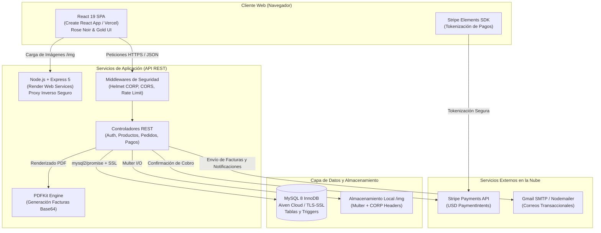
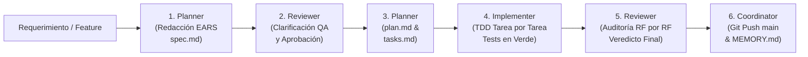

# Afrolash — Plataforma E-Commerce de Cosméticos y Belleza

[](https://react.dev/)
[](https://nodejs.org/)
[](https://expressjs.com/)
[](https://www.mysql.com/)
[](https://owasp.org/)
[](specs/)
[](https://opensource.org/licenses/ISC)

> **Afrolash C.A.** es una plataforma de comercio electrónico de alta gama especializada en cosméticos y productos para el realce y cuidado de pestañas y cejas. Diseñada bajo la estética editorial cosmética **"Rose Noir & Gold"**, combina una experiencia de compra fluida y accesible (WCAG 2.1 AA) con una arquitectura desacoplada full-stack robusta, blindada bajo los estándares de seguridad **OWASP Top 10** y preparada para desplegarse en infraestructura cloud 100% gratuita.

---

## Tabla de Contenidos

1. [Visión General y Funcionalidades](#visión-general-y-funcionalidades)
2. [Arquitectura del Sistema](#arquitectura-del-sistema)
3. [Stack Tecnológico](#stack-tecnológico)
4. [Seguridad Web y Hardening (OWASP Top 10)](#seguridad-web-y-hardening-owasp-top-10)
5. [Metodología de Ingeniería: Spec-Driven Development (SDD)](#metodología-de-ingeniería-spec-driven-development-sdd)
6. [Instalación y Ejecución Local](#instalación-y-ejecución-local)
7. [Pruebas Automatizadas y Verificación](#pruebas-automatizadas-y-verificación)
8. [Cuentas de Demostración](#cuentas-de-demostración)
9. [Despliegue en Producción (Cloud Gratuito)](#despliegue-en-producción-cloud-gratuito)
10. [Estructura del Proyecto](#estructura-del-proyecto)

---

## Visión General y Funcionalidades

Afrolash ofrece una experiencia integral tanto para compradores exigentes como para el equipo administrativo y operativo:

### Experiencia del Cliente (Tienda y Checkout)
- **Catálogo Editorial Interactivo**: Exploración de productos con carrusel promocional de alta definición, filtrado dinámico y etiquetas de estado de inventario.
- **Ficha Técnica Detallada**: Cada cosmético cuenta con desglose de ingredientes, instrucciones de uso ilustradas, consejos profesionales de aplicación y precauciones sanitarias.
- **Carrito Persistente**: Gestión de productos con almacenamiento local (`localStorage`), control de existencias en tiempo real y cálculo reactivo de subtotales.
- **Checkout Guiado de 4 Etapas**:
  1. *Resumen de Compra*: Verificación final de cantidades e importes.
  2. *Información de Entrega*: Registro validado de dirección física y teléfono de contacto.
  3. *Pago Seguro en Línea*: Integración directa con **Stripe Elements** (procesamiento en USD sin exposición de datos de tarjeta en servidores propios).
  4. *Confirmación y Facturación*: Generación instantánea de factura PDF en Base64 para descarga directa y envío asíncrono por correo electrónico vía SMTP.
- **Gestión de Perfil e Historial**: Panel de cliente para actualización de datos personales y seguimiento histórico de órdenes con trazabilidad de estados (`pendiente`, `pagado`, `enviado`, `entregado`, `cancelado`).
- **Navegación Accesible**: Cumplimiento WCAG 2.1 AA con navegación por teclado (`Tab`, `Escape`), estados `:focus-visible` de alto contraste, modales accesibles con trampas de foco y toasts no intrusivos.
- **Soporte y Canales Legales**: Enlace directo de atención al cliente vía WhatsApp flotante y vistas completas para Términos y Condiciones y Políticas de Privacidad.

### Panel de Control Administrativo y Operativo (RBAC)
Control de acceso estricto basado en roles (`cliente`, `empleado`, `admin`):
- **Inventario Cosmético**: Alta, edición, conmutación de visibilidad y ajuste de existencias de productos con subida de imágenes optimizadas mediante Multer.
- **Operaciones y Ventas**: Visualización y actualización en tiempo real de estados de despacho de pedidos para el personal de almacén y logística (`empleado` y `admin`).
- **Métricas y Analíticas**: Gráficos interactivos de ingresos brutos, volumen de transacciones y cosméticos más demandados desarrollados con **Recharts**.
- **Gestión de Personal**: Módulo exclusivo para `admin` con capacidad de crear cuentas de empleados con contraseñas temporales enviadas por correo y revocación de accesos.

---

## Arquitectura del Sistema

La solución adopta una **arquitectura desacoplada en tres capas** (Frontend SPA, Backend REST API y Persistencia Relacional), permitiendo escalabilidad independiente, alta cohesión y despliegue modular:



---

## Stack Tecnológico

| Capa / Dominio | Tecnologías Principales | Propósito y Justificación |
| :--- | :--- | :--- |
| **Frontend SPA** | React 19, React Router DOM 7, Axios | Interfaz responsiva y reactiva con gestión desacoplada de estado. |
| **Estilos & Diseño** | CSS Nativo modular (Tokens de diseño), React Icons | Sistema cosmético "Rose Noir & Gold" sin librerías pesadas externas. |
| **Visualización** | Recharts 3 | Gráficos interactivos de ingresos y métricas operativas. |
| **Pasarela de Pago** | `@stripe/react-stripe-js`, `@stripe/stripe-js` | Integración PCI-DSS compliant para cobros en línea con Stripe Elements. |
| **Backend API** | Node.js 18+, Express 5 | Servidor REST asíncrono de alto rendimiento con enrutamiento modular. |
| **Base de Datos** | MySQL 8 (InnoDB), `mysql2/promise` | Integridad referencial estricta, triggers de auditoría y consultas parametrizadas. |
| **Seguridad HTTP** | Helmet 8, CORS, Express Rate Limit | Blindaje de cabeceras, CORP, CORS restringido por origen y mitigación de fuerza bruta. |
| **Autenticación** | JSON Web Tokens (`jsonwebtoken`), `bcryptjs` | Sesiones stateless seguras con RBAC de 3 niveles y contraseñas salteadas. |
| **Procesamiento PDF & Mail** | PDFKit, Nodemailer | Generación de facturas electrónicas y despacho de correos transaccionales. |
| **Pruebas Automatizadas** | Jest 30, React Testing Library, Supertest | Cobertura integral frontend y backend con suites de integración y unitarias. |
| **DevOps & Cloud** | Vercel (SPA), Render (API), Aiven (MySQL) | Infraestructura de producción moderna, escalable y 100% gratuita. |

---

## Seguridad Web y Hardening (OWASP Top 10)

Afrolash implementa defensas en profundidad auditadas y verificadas bajo la especificación **Spec 003**:

1. **A01:2021 — Control de Acceso Roto (Broken Access Control)**:
   - Control de acceso basado en roles (RBAC) estricto con middlewares dedicados (`authMiddleware`, `verificarPersonal`, `adminMiddleware`).
   - Inmunidad contra **IDOR** (*Insecure Direct Object References*): las consultas de pedidos y perfil vinculan forzosamente los registros al `id_usuario` verificado en el token JWT, impidiendo el acceso a datos ajenos.
2. **A02:2021 — Fallas Criptográficas (Cryptographic Failures)**:
   - Hashing irreversible de contraseñas mediante `bcryptjs` con costo de 10 rondas de sal.
   - Tokens JWT firmados criptográficamente mediante algoritmo HS256 con expiración temporal.
   - Conexiones de base de datos cifradas mediante **TLS/SSL** condicional (`DB_SSL=true`) en la nube.
3. **A03:2021 — Inyección (Injection)**:
   - Inmunidad contra **SQL Injection**: consultas 100% parametrizadas con marcadores de posición (`?`) mediante el pool asíncrono de `mysql2/promise`. Cero concatenación directa de cadenas.
   - Sanitización y escape de entidades HTML en correos transaccionales para neutralizar inyecciones de plantillas en clientes de correo.
4. **A04:2021 — Diseño Inseguro (Insecure Design)**:
   - **Transacciones Atómicas**: El procesamiento de órdenes de compra utiliza transacciones MySQL completas (`beginTransaction`, `commit`, `rollback`) con bloqueo pesimista `SELECT ... FOR UPDATE`, garantizando consistencia absoluta de stock ante compras concurrentes.
   - **Anti-Price Tampering**: El servidor recalcula autoritativamente el precio unitario y el monto total consultando la base de datos, ignorando cualquier precio manipulado enviado desde el cliente.
5. **A05:2021 — Configuración de Seguridad Incorrecta (Security Misconfiguration)**:
   - Cabeceras HTTP seguras aplicadas con **Helmet 8** y política de recursos cruzados `Cross-Origin-Resource-Policy: cross-origin` para servir imágenes multimedia de forma segura.
   - Política **CORS Restrictiva** condicionada al origen configurado en `FRONTEND_URL`, emitiendo código HTTP `403 Forbidden` JSON ante dominios no autorizados.
   - Configuración precisa de proxy inverso mediante `TRUST_PROXY=1` (1 salto numérico exacto) para evitar suplantaciones de IP (*IP spoofing*) detrás de balanceadores en la nube.
6. **A06:2021 — Componentes Vulnerables y Obsoletos**:
   - Dependencias auditadas periódicamente (`npm audit`). Se solventaron todas las vulnerabilidades críticas y altas mediante directivas `overrides` en `package.json`, manteniendo cero vulnerabilidades en el runtime de producción.
7. **A07:2021 — Fallas de Identificación y Autenticación**:
   - **Rate Limiting Cuantitativo**: El endpoint de autenticación restringe intentos de inicio de sesión a un máximo de 15 solicitudes por ventana de 15 minutos por IP para neutralizar ataques de fuerza bruta y relleno de credenciales.
   - Política de contraseñas robustas (mínimo 8 caracteres, al menos una letra mayúscula y al menos un dígito numérico).
8. **A08:2021 — Fallas en la Integridad del Software y de los Datos**:
   - Límite de tamaño en cuerpos JSON a 100 KB (`express.json({ limit: '100kb' })`) para mitigar ataques de denegación de servicio (DoS).
   - Subida segura de imágenes mediante Multer con límite de 2 MB y máximo 3 archivos, filtrado estricto por tipo MIME (JPEG, JPG, PNG, WEBP) y limpieza física automática de archivos temporales en disco ante errores o rechazos de validación.
9. **A09:2021 — Fallas en el Registro y Monitoreo de Seguridad**:
   - Disparadores de base de datos automáticos (`trg_pedidos_update`, `trg_productos_insert`, `trg_productos_update`, `trg_productos_delete`, `trg_usuarios_update`, `trg_usuarios_delete`) que escriben de forma inmutable cada mutación en la tabla `auditoria`.
   - Endpoint de diagnóstico de salud operacional `GET /api/health` con verificación activa de base de datos (`SELECT 1`).

---

## Metodología de Ingeniería: Spec-Driven Development (SDD)

El desarrollo del proyecto Afrolash se rige estrictamente por la metodología **Spec-Driven Development (SDD)** operada por un equipo de agentes especializados con perfiles de ingeniería diferenciados:



- **Especificaciones EARS**: Cada requerimiento se formula bajo la sintaxis estandarizada *Easy Approach to Requirements Syntax* (Ubicuo, Guiado por Evento, Guiado por Estado y Comportamiento No Deseado).
- **Enfoque TDD**: Ninguna funcionalidad se considera completada sin pruebas automatizadas previas o simultáneas que garanticen cero regresiones.
- **Historial de Especificaciones**:
  - `specs/001-remediacion-vulnerabilidades-npm/`: Auditoría y saneamiento de dependencias.
  - `specs/002-mejora-integral-frontend/`: Sistema visual "Rose Noir & Gold", checkout modular y accesibilidad WCAG.
  - `specs/003-seguridad-y-hardening-web/`: Blindaje OWASP Top 10, transacciones atómicas y recálculo autoritativo.
  - `specs/004-preparacion-produccion-y-despliegue/`: Portabilidad cloud gratuita, endpoints de salud y estándar de portafolio.

---

## Instalación y Ejecución Local

### Requisitos Previos
- **Node.js**: v18.0.0 o superior ([Descargar Node.js](https://nodejs.org/)).
- **MySQL Server**: v8.0 o superior (en ejecución local en el puerto `3306`).
- **Git**: Para clonar el repositorio.

### Paso 1: Clonar el Repositorio
```powershell
git clone https://github.com/tu-usuario/Afrolash.git
cd Afrolash
```

### Paso 2: Inicializar la Base de Datos Local
Ejecuta los scripts idempotentes de esquema y datos semilla en tu servidor MySQL:
```powershell
# En Windows PowerShell o terminal con MySQL CLI:
mysql -u root -p -e "source database/schema.sql"
mysql -u root -p -e "source database/seed.sql"
```
*(También puedes abrir y ejecutar `database/schema.sql` seguido de `database/seed.sql` en MySQL Workbench o DBeaver).*

### Paso 3: Configurar Variables de Entorno
Copia los archivos de plantilla y asigna tus credenciales locales:

```powershell
# Configuración del Backend:
Copy-Item server/.env.example server/.env

# Configuración del Frontend:
Copy-Item client/.env.example client/.env
```

Edita `server/.env` con tus credenciales de MySQL:
```env
PORT=5000
NODE_ENV=development
TRUST_PROXY=false
DB_HOST=localhost
DB_USER=root
DB_PASSWORD=tu_password_local
DB_NAME=afrolash_db
DB_PORT=3306
DB_SSL=false
JWT_SECRET=tu_clave_secreta_jwt_de_desarrollo
STRIPE_SECRET_KEY=sk_test_tu_clave_de_prueba_stripe
EMAIL_USER=tu_correo@gmail.com
EMAIL_PASS=tu_clave_de_aplicacion
FRONTEND_URL=http://localhost:3000
```

*(En `client/.env`, la variable `REACT_APP_API_URL` puede dejarse comentada o configurada en `http://localhost:5000` ya que el cliente asume dicho valor automáticamente como respaldo).*

### Paso 4: Instalar Dependencias
```powershell
# Instalar dependencias del servidor:
npm --prefix server install

# Instalar dependencias del cliente:
npm --prefix client install
```

### Paso 5: Iniciar la Aplicación en Desarrollo
Inicia ambos servicios en terminales separadas:

```powershell
# Terminal 1 — Backend API (http://localhost:5000):
npm --prefix server run dev

# Terminal 2 — Frontend SPA (http://localhost:3000):
npm --prefix client start
```

---

## Pruebas Automatizadas y Verificación

El proyecto cuenta con suites automatizadas que validan lógica de negocio, integración con base de datos, seguridad y componentes React:

```powershell
# 1. Pruebas de Backend (Auditoría SQL, Seguridad OWASP y Producción):
npm --prefix server test

# 2. Pruebas de Frontend (36 pruebas Jest / React Testing Library):
npm --prefix client test -- --watchAll=false

# 3. Compilación de Producción del Frontend (Cero errores y cero advertencias ESLint):
npm --prefix client run build

# 4. Verificación Sintáctica Estricta del Backend:
node --check server/index.js
node --check server/config/db.js
```

---

## Cuentas de Demostración

La base de datos incluye cuentas precargadas en `database/seed.sql` con credenciales de prueba pre-hasheadas con `bcryptjs` (salt rounds 10) que cumplen con la política de seguridad:

| Rol | Correo Electrónico | Contraseña | Capacidades y Vistas Accesibles |
| :--- | :--- | :--- | :--- |
| **Administrador** | `admin@afrolash.com` | `AdminAfro2026` | Acceso irrestricto: Gráficas y Métricas (Recharts), Gestión de Inventario (CRUD y stock), Control de Ventas/Pedidos y Administración de Usuarios/Personal. |
| **Empleado** | `empleado@afrolash.com` | `EmpleadoAfro2026` | Gestión Operativa: Visualización de inventario cosmético y administración de pedidos y estados de despacho. |
| **Cliente** | `cliente@afrolash.com` | `ClienteAfro2026` | Experiencia de Compra: Navegación de catálogo, carrito persistente, checkout con Stripe, descarga de facturas PDF, perfil y mis pedidos. |

---

## Despliegue en Producción (Cloud Gratuito)

Afrolash está arquitectónicamente preparado para desplegarse en infraestructura en la nube **100% gratuita** y sin tarjeta de crédito requerida:
- **Base de Datos**: Aiven for MySQL Free Tier (con TLS/SSL gestionado y soporte de triggers).
- **Backend API**: Render Web Services Free Tier (con proxy inverso, `/api/health` y servido de imágenes con CORP).
- **Frontend SPA**: Vercel Free Tier (con reescritura de rutas SPA y CDN global).

👉 Consulta la guía detallada paso a paso:  
**[Guía de Despliegue en Producción Gratuita](docs/deployment.md)**

---

## Estructura del Proyecto

```text
Afrolash/
├── client/                     # Frontend SPA en React 19
│   ├── public/                 # Plantilla HTML, iconos y reglas SPA (_redirects)
│   │   └── img/                # Catálogo de imágenes cosméticas servidas estáticamente
│   ├── src/
│   │   ├── components/         # Vistas principales (Inicio, Catalogo, Carrito, etc.)
│   │   │   └── admin/          # Submódulos RBAC (Inventario, Ventas, Metricas, Usuarios)
│   │   ├── config/             # Configuración centralizada de API (api.js)
│   │   ├── App.js              # Enrutador por estado, interceptores Axios y shell visual
│   │   └── *.test.js           # Suites de pruebas Jest y React Testing Library
│   ├── .env.example            # Plantilla de variables de entorno para React
│   └── vercel.json             # Reglas de reescritura SPA para despliegue en Vercel
├── server/                     # Backend API REST en Node.js y Express 5
│   ├── config/                 # Pool de conexiones MySQL con soporte SSL (db.js)
│   ├── controllers/            # Controladores desacoplados (auth, productos, pedidos, etc.)
│   ├── middleware/             # Middlewares (auth JWT, admin, personal, upload Multer)
│   ├── routes/                 # Rutas REST de la API Express
│   ├── utils/                  # Generador de facturas PDFKit y transporte Nodemailer
│   ├── *.test.js               # Suites de integración backend (auditoria, seguridad, produccion)
│   ├── .env.example            # Plantilla de variables de entorno para Express
│   └── index.js                # Entrada Express, Helmet, CORS, Rate Limit y Health Check
├── database/                   # Scripts SQL reproducibles e idempotentes
│   ├── schema.sql              # DDL: Base de datos, tablas InnoDB y 6 triggers de auditoría
│   └── seed.sql                # DML: Catálogo cosmético base y usuarios de demostración
├── docs/                       # Documentación técnica de arquitectura y gobernanza
│   ├── constitution.md         # Principios técnicos no negociables del proyecto
│   └── deployment.md           # Guía paso a paso de despliegue cloud 100% gratuito
├── specs/                      # Especificaciones del flujo Spec-Driven Development (001 a 004)
├── AGENTS.md                   # Definición y reglas de gobernanza del equipo multiagente
├── MEMORY.md                   # Registro vivo de decisiones arquitectónicas y progreso
└── README.md                   # Portafolio profesional del proyecto Afrolash
```

---

## Licencia

Este proyecto se distribuye bajo la licencia **ISC**. Consulta los términos legales en los archivos del repositorio. Desarrollado con dedicación para **Afrolash C.A.**
