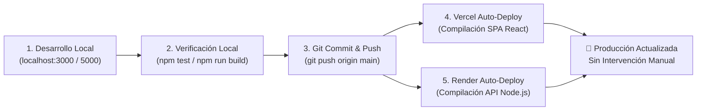

# Guía de Despliegue en Producción 100% Gratuita — Afrolash

Esta guía documenta el procedimiento completo, verificado y reproducible para desplegar la plataforma **Afrolash** en la nube utilizando exclusivamente proveedores con **planes gratuitos permanentes (Free Tier)** y sin necesidad de registrar tarjetas de crédito:

- **Base de Datos Relacional**: [Aiven for MySQL](https://aiven.io/) (Plan gratuito de MySQL 8 administrado con TLS/SSL y soporte completo de triggers e InnoDB). Alternativa: [TiDB Serverless](https://tidbcloud.com/).
- **Backend API REST**: [Render Web Services](https://render.com/) (Plan gratuito Node.js con soporte de proxy inverso, health checks y servido estático).
- **Frontend SPA**: [Vercel](https://vercel.com/) (Plan gratuito Hobby con red CDN global de alto rendimiento y reescritura de rutas SPA). Alternativa: [Netlify](https://www.netlify.com/).
- **Pasarela de Pagos**: [Stripe](https://stripe.com/) (Modo de pruebas / Sandbox con tarjetas de test).
- **Correos Transaccionales**: Google SMTP / Nodemailer (Contraseña de aplicación de Gmail).

---

## Índice de Contenidos

1. [Arquitectura de Despliegue Cloud](#1-arquitectura-de-despliegue-cloud)
2. [Paso 1: Base de Datos Relacional en Aiven for MySQL](#paso-1-base-de-datos-relacional-en-aiven-for-mysql)
3. [Paso 2: Backend API REST en Render Web Services](#paso-2-backend-api-rest-en-render-web-services)
4. [Paso 3: Frontend SPA en Vercel](#paso-3-frontend-spa-en-vercel)
5. [Paso 4: Verificación Post-Despliegue y Consideraciones del Free Tier](#paso-4-verificación-post-despliegue-y-consideraciones-del-free-tier)
6. [Paso 5: Flujo de Trabajo Continuo (CI/CD) desde Local](#paso-5-flujo-de-trabajo-continuo-cicd-desde-local)

---

## 1. Arquitectura de Despliegue Cloud

```mermaid
flowchart TD
    USUARIO(["👤 Usuario / Navegador"])

    subgraph Vercel ["Vercel (Frontend Global CDN)"]
        SPA["React 19 SPA\nDominio: https://afrolash.vercel.app\nConfig: vercel.json / _redirects"]
    end

    subgraph Render ["Render Web Services (Backend Compute)"]
        PROXY["Reverse Proxy / SSL Terminator\n(TRUST_PROXY = 1)"]
        API["Node.js + Express 5\nDominio: https://afrolash-api.onrender.com\nRoot Directory: .\nHealth: /api/health"]
        MEDIA["Directorios Estáticos\n/img (CORP Cross-Origin)"]
        PROXY --> API
        API --> MEDIA
    end

    subgraph Aiven ["Aiven Cloud (Database)"]
        MYSQL[("MySQL 8.0 InnoDB\nHost: mysql-xxx.aivencloud.com\nCifrado TLS/SSL Obligatorio\nEsquema: defaultdb\nTriggers de Auditoría")]
    end

    subgraph Pasarelas ["Servicios de Terceros"]
        STRIPE["Stripe Elements API\n(USD Sandbox)"]
        GMAIL["Gmail SMTP Server\n(Notificaciones y Facturas)"]
    end

    USUARIO -->|HTTPS Petición SPA| SPA
    SPA -->|CORS Restringido HTTPS /api| PROXY
    SPA -->|Carga de Imágenes /img| MEDIA
    SPA -->|Tokenización Tarjeta| STRIPE
    API -->|Conexión Segura TLS/SSL (DB_SSL=true)| MYSQL
    API -->|Confirmación PaymentIntent| STRIPE
    API -->|Factura PDF Base64 por SMTP| GMAIL
```

---

## Paso 1: Base de Datos Relacional en Aiven for MySQL

**Aiven for MySQL** ofrece un plan gratuito que incluye una instancia gestionada de MySQL 8.0 con 1 GB de RAM, 5 GB de almacenamiento y soporte nativo para almacenamiento InnoDB, transacciones ACID y disparadores (*triggers*) SQL.

### 1.1. Crear el Servicio en Aiven
1. Regístrate en [Aiven.io](https://aiven.io/) (puedes registrarte con tu cuenta de GitHub).
2. Haz clic en **"Create service"**.
3. Selecciona el servicio **MySQL**.
4. Elige el plan **Free** (disponible en regiones seleccionadas de AWS o Google Cloud, por ejemplo `us-east-1` o `europe-west3`).
5. Asigna un nombre al servicio (ej. `afrolash-mysql`) y haz clic en **"Create free service"**.
6. Espera entre 2 y 3 minutos hasta que el estado del servicio cambie a **"Running"**.

### 1.2. Obtener Parámetros de Conexión
En el panel del servicio recién creado, localiza la sección **"Connection information"**:
- **Host**: `mysql-xxxx-tuproyecto.aivencloud.com`
- **Port**: `12345` (puerto asignado aleatoriamente)
- **User**: `avnadmin`
- **Password**: *(Haz clic en "Show" para copiar la contraseña generada)*
- **Database Name**: Por defecto es `defaultdb`.
- **SSL Mode**: `REQUIRED` (Aiven exige conexiones cifradas TLS/SSL por defecto).

### 1.3. Importar Esquema y Datos Semilla

> [!IMPORTANT]
> **Adaptación de la directiva `USE`**: Los archivos `database/schema.sql` y `database/seed.sql` contienen por defecto la directiva `USE afrolash_db;`. Dado que Aiven aprovisiona una base de datos denominada `defaultdb`, debes indicar a tu cliente MySQL que utilice `defaultdb` o comentar la instrucción `USE` en los scripts.

#### Opción A: Mediante MySQL CLI (Recomendada)
Ejecuta los siguientes comandos desde tu terminal (reemplazando los marcadores con tus valores de Aiven):

```bash
# 1. Importar tablas, índices y disparadores de auditoría:
mysql --host=mysql-xxxx-tuproyecto.aivencloud.com \
      --port=12345 \
      --user=avnadmin \
      --password=TU_PASSWORD_AIVEN \
      --ssl-mode=REQUIRED \
      --database=defaultdb < database/schema.sql

# 2. Poblar el catálogo cosmético y las cuentas de demostración:
mysql --host=mysql-xxxx-tuproyecto.aivencloud.com \
      --port=12345 \
      --user=avnadmin \
      --password=TU_PASSWORD_AIVEN \
      --ssl-mode=REQUIRED \
      --database=defaultdb < database/seed.sql
```

#### Opción B: Mediante DBeaver o MySQL Workbench
1. Crea una nueva conexión seleccionando el driver **MySQL 8**.
2. Ingresa Host, Puerto, Usuario (`avnadmin`) y Contraseña.
3. En la pestaña **SSL**, selecciona *SSL mode: Require* o *Verify CA*.
4. Abre y ejecuta `database/schema.sql` (asegúrate de seleccionar el esquema activo `defaultdb`).
5. Abre y ejecuta `database/seed.sql`.

---

## Paso 2: Backend API REST en Render Web Services

Render permite desplegar servicios web en Node.js de forma gratuita, con soporte para certificados SSL automáticos, variables de entorno y monitoreo de salud (*health checks*).

### 2.1. Crear el Web Service en Render
1. Inicia sesión en [Render.com](https://render.com/) con tu cuenta de GitHub.
2. En el Dashboard, haz clic en **"New +"** y selecciona **"Web Service"**.
3. Selecciona la opción **"Build and deploy from a Git repository"** y elige tu repositorio `Afrolash`.
4. Completa la configuración obligatoria del servicio:
   - **Name**: `afrolash-api` (o el subdominio que prefieras).
   - **Region**: Selecciona la región geográfica más cercana a tu base de datos de Aiven (ej. *Ohio (US East)* o *Frankfurt (EU Central)*).
   - **Branch**: `main`.
   - **Root Directory**: `.` *(Escribe un punto literal. NO coloques `server`)*.
     > [!WARNING]
     > **Por qué `Root Directory: .` es crítico**: El backend de Express y el middleware de carga Multer resuelven la ruta de imágenes relativas hacia `client/public/img/`. Si configuras `Root Directory: server`, Render ignorará la carpeta `client`, rompiendo el servido y almacenamiento de imágenes estáticas del catálogo cosmético.
   - **Runtime**: `Node`.
   - **Build Command**: `npm --prefix server install`
   - **Start Command**: `npm --prefix server start`
   - **Instance Type**: `Free` ($0/mo).

### 2.2. Configuración del Health Check Path
Despliega la sección **"Advanced"** en la parte inferior y configura:
- **Health Check Path**: `/api/health`
  *(Render consultará periódicamente este endpoint para validar que el servicio y la base de datos se encuentren operativos).*

### 2.3. Configurar Variables de Entorno en Render
En la sección **"Environment Variables"**, agrega las siguientes claves y valores:

| Clave | Valor Recomendado / Descripción |
| :--- | :--- |
| `NODE_ENV` | `production` |
| `TRUST_PROXY` | `1` *(Habilita 1 salto numérico exacto para el proxy de Render, previniendo advertencias de Express y garantizando el correcto funcionamiento del Rate Limiting)*. |
| `DB_HOST` | Host de Aiven (ej. `mysql-xxxx-tuproyecto.aivencloud.com`). |
| `DB_PORT` | Puerto de Aiven (ej. `12345`). |
| `DB_USER` | `avnadmin` |
| `DB_PASSWORD` | Contraseña asignada en el panel de Aiven. |
| `DB_NAME` | `defaultdb` |
| `DB_SSL` | `true` *(Instruye a `mysql2/promise` a negociar conexión cifrada TLS)*. |
| `DB_SSL_REJECT_UNAUTHORIZED` | `false` *(Permite admitir certificados gestionados por la nube sin requerir cargar una autoridad certificadora personalizada en el contenedor)*. |
| `JWT_SECRET` | Una cadena secreta criptográficamente robusta (mínimo 32 caracteres aleatorios). |
| `STRIPE_SECRET_KEY` | Clave secreta de pruebas de Stripe (`sk_test_...`). |
| `EMAIL_USER` | Tu dirección de correo de Gmail para despacho SMTP. |
| `EMAIL_PASS` | Contraseña de aplicación de 16 caracteres generada en Google Account. |
| `FRONTEND_URL` | URL de la SPA en Vercel (ej. `https://afrolash.vercel.app`). *Si aún no has desplegado en Vercel, coloca temporalmente `http://localhost:3000` o la URL provisional de Vercel y actualízala al finalizar el Paso 3*. |

5. Haz clic en **"Create Web Service"**.
6. Render iniciará la compilación. Una vez finalizado, verás el estado en verde **"Live"** y dispondrás de tu URL pública (ej. `https://afrolash-api.onrender.com`).

---

## Paso 3: Frontend SPA en Vercel

Vercel proporciona una plataforma optimizada para aplicaciones React, entregando activos estáticos a través de una red Edge CDN global con recarga ultrarrápida y certificados SSL automáticos.

### 3.1. Importar el Proyecto en Vercel
1. Inicia sesión en [Vercel.com](https://vercel.com/) con tu cuenta de GitHub.
2. Haz clic en **"Add New..."** -> **"Project"**.
3. Importa tu repositorio `Afrolash`.
4. En la pantalla de configuración del proyecto (**Configure Project**):
   - **Project Name**: `afrolash` (o el nombre de tu preferencia).
   - **Framework Preset**: `Create React App`.
   - **Root Directory**: Haz clic en **"Edit"**, selecciona la carpeta **`client`** y haz clic en **"Continue"**.
   - Los comandos de construcción se detectarán automáticamente:
     - *Build Command*: `react-scripts build` (o `npm run build`).
     - *Output Directory*: `build`.

### 3.2. Configurar Variables de Entorno en Vercel
Despliega la sección **"Environment Variables"** y define:

| Clave | Valor |
| :--- | :--- |
| `REACT_APP_API_URL` | La URL pública de tu API desplegada en Render (ej. `https://afrolash-api.onrender.com`). **Asegúrate de NO incluir barra final `/`**. |
| `REACT_APP_STRIPE_PUBLISHABLE_KEY` | Tu clave pública de pruebas de Stripe (`pk_test_...`). |

### 3.3. Enrutamiento SPA y Despliegue
El proyecto ya cuenta con las reglas de reescritura necesarias empaquetadas en:
- `client/vercel.json`: Regla de reescritura `source: "/(.*)" -> destination: "/index.html"`.
- `client/public/_redirects`: Regla universal `/* /index.html 200`.

Estas reglas garantizan que al recargar la página o acceder a enlaces profundos de autenticación (ej. `/?vista=restablecer&id=1&token=abc`), Vercel entregue la aplicación SPA con código HTTP `200 OK` en lugar de emitir un error `404 Not Found`.

5. Haz clic en **"Deploy"**.
6. Vercel compilará la SPA en aproximadamente 1 minuto y generará tu dominio definitivo (ej. `https://afrolash.vercel.app`).

### 3.4. Actualización del Origen CORS en Render
Para que la API acepte peticiones seguras desde la SPA en producción:
1. Copia tu dominio de Vercel (ej. `https://afrolash.vercel.app`).
2. Ve al panel de **Render** -> Selecciona tu servicio `afrolash-api` -> Pestaña **"Environment"**.
3. Edita la variable `FRONTEND_URL` asignándole exactamente la URL de tu SPA en Vercel:
   ```env
   FRONTEND_URL=https://afrolash.vercel.app
   ```
4. Guarda los cambios. Render reiniciará automáticamente la API aplicando la nueva política de CORS.

---

## Paso 4: Verificación Post-Despliegue y Consideraciones del Free Tier

### 4.1. Verificación del Health Check
Comprueba el estado del backend y la conectividad activa con la base de datos de Aiven enviando una petición HTTP GET:

```bash
curl -i https://afrolash-api.onrender.com/api/health
```

**Respuesta esperada (HTTP 200 OK)**:
```json
{
  "status": "ok",
  "database": "connected",
  "timestamp": "2026-11-16T23:00:00.000Z"
}
```

### 4.2. Verificación Funcional de Extremo a Extremo
1. **Catálogo e Imágenes**: Abre `https://afrolash.vercel.app` en tu navegador. Comprueba que el carrusel promocional cargue fluidamente y que las imágenes cosméticas de los productos se sirvan correctamente desde `https://afrolash-api.onrender.com/img/...` con cabecera `Cross-Origin-Resource-Policy: cross-origin`.
2. **Inicio de Sesión Demo**:
   - Inicia sesión como Administrador con `admin@afrolash.com` y contraseña `AdminAfro2026`.
   - Verifica el acceso a las pestañas de Inventario, Ventas, Gráficos de Métricas (Recharts) y Gestión de Usuarios.
3. **Flujo de Compra**:
   - Inicia sesión con la cuenta cliente `cliente@afrolash.com` y contraseña `ClienteAfro2026`.
   - Agrega un cosmético al carrito y avanza por las 4 etapas del checkout.
   - Utiliza una tarjeta de pruebas de Stripe (ej. `4242 4242 4242 4242`).
   - Verifica la confirmación del pedido y la descarga instantánea de la factura PDF generada por el backend.

### 4.3. Consideraciones Técnicas Transparentes del Plan Gratuito

> [!NOTE]
> **1. Suspensión por Inactividad en Render (*Spin-down* / *Cold Start*)**:
> En el plan gratuito de Render, el servicio entra en modo de reposo tras 15 minutos consecutivos sin recibir peticiones HTTP. La primera petición subsiguiente activará el contenedor, lo que puede demorar entre **30 y 50 segundos** (*arranque en frío*). Las peticiones posteriores responderán de forma inmediata. La SPA de React cuenta con estados visuales de carga para gestionar con elegancia este tiempo de reactivación.

> [!WARNING]
> **2. Sistema de Archivos Efímero en Render**:
> Los contenedores del plan gratuito de Render disponen de un sistema de archivos efímero (*ephemeral filesystem*). El catálogo de imágenes base empaquetado en el repositorio (`client/public/img/`) es permanente y se restaura íntegramente en cada despliegue. No obstante, si un administrador sube una **nueva imagen** desde el panel en producción, dicha imagen se almacenará en el disco local temporal del contenedor y se reinicializará si Render reinicia el servicio o redespliega.  
> *Recomendación arquitectónica para escala*: Para producción masiva con subida continua de imágenes por usuarios finales, se recomienda integrar un servicio de almacenamiento de objetos desacoplado (como Amazon S3, Cloudinary o Supabase Storage).

---

## Paso 5: Flujo de Trabajo Continuo (CI/CD) desde Local

Todo el pipeline de despliegue continuo se encuentra vinculado a tu repositorio de GitHub. Para publicar futuras mejoras, correcciones o características:



### Protocolo Recomendado antes de Publicar:
1. Valida las pruebas de backend y frontend en local:
   ```powershell
   npm --prefix server test
   npm --prefix client test -- --watchAll=false
   ```
2. Asegura que la compilación de producción de React finalice sin advertencias:
   ```powershell
   npm --prefix client run build
   ```
3. Verifica la sintaxis del backend:
   ```powershell
   node --check server/index.js
   ```
4. Envía tus cambios a GitHub:
   ```powershell
   git add .
   git commit -m "feat(alcance): descripción concisa de los cambios"
   git push origin main
   ```
5. Tanto **Vercel** como **Render** detectarán el nuevo commit en la rama `main` y comenzarán sus respectivos procesos de construcción y redespliegue automático de forma paralela y transparente.
